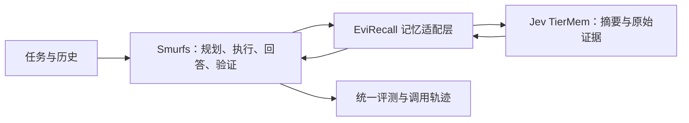

# EviRecall

**Evidence-Aware Memory for Long-Horizon Multi-Agent Tasks**

面向多智能体长程任务的证据感知记忆研究。

EviRecall 计划以 **Smurfs** 为多 Agent 底座，评估接入 **Jev TierMem** 的轻量分层记忆，并研究共享记忆中的过期证据、冲突与错误传播。

**阶段：proposal v0.1 / 方案讨论，2026-10-27。** Smurfs 已确定；Jev 接入、数据集组合、改进机制和实验规模仍需小规模验证。本仓库目前交付方案文档，尚无 EviRecall 端到端实现或性能结果。

## 阅读入口

- [Proposal 正文](docs/proposal.md)：研究问题、选型、方法、评测、分工、风险。
- [Proposal PDF](output/pdf/evirecall-proposal-v0.1.pdf)：便于分享的中文阅读版。
- [Smurfs 与 Jev 接入设计](docs/design-smurfs-jev.md)：实际接口、插入位置、状态边界与待实现部分。
- [讨论与决策记录](docs/decision-log.md)：讨论如何收敛，区分确定、建议和待验证事项。
- [三人分工与阶段计划](docs/team-plan.md)：负责人占位、交付物、验收与依赖。
- [参考资料](docs/references.md) / [BibTeX](docs/references.bib)：论文、软件文档与引用边界。
- [2026-10-27 来源与可行性核对](docs/source-audit-2026-10-27.md)：检查过的源码版本与验证范围。

## 当前拟议流程



Jev TierMem 作为记忆组件接入，不启动其自带的独立 Agent loop。默认先评估 Python 接入；MCP 是后续可选适配方式。

## 修改文档

`docs/proposal.md` 是正文源文件。生成 LaTeX 源：

```bash
python scripts/build_proposal.py
```

安装 XeLaTeX、ctex、hyperref、geometry、enumitem 后，生成 PDF：

```bash
python scripts/build_proposal.py --pdf
```

脚本会生成 `docs/proposal.tex` 与 `output/pdf/evirecall-proposal-v0.1.pdf`。阅读版不是教师指定模板；正式提交前应套用课程最新模板并补全成员信息。参考条目的可读版本与 BibTeX 同时维护。

## 协作与归属

建议按 `docs/`、`feat/`、`eval/` 分支提交小改动，关联实验配置和结果；角色分配见团队计划。研究假设、已实现功能、已测结果分别标记。

本项目拟复用 [FreedomIntelligence/Smurfs](https://github.com/FreedomIntelligence/Smurfs) 与 [FreedomIntelligence/Tiermem](https://github.com/FreedomIntelligence/Tiermem)。上游算法和软件能力归原作者；EviRecall 的适配、改进和实验结果须单独说明。本仓库未收录上游源码、课程课件、模型权重或完整数据集。
