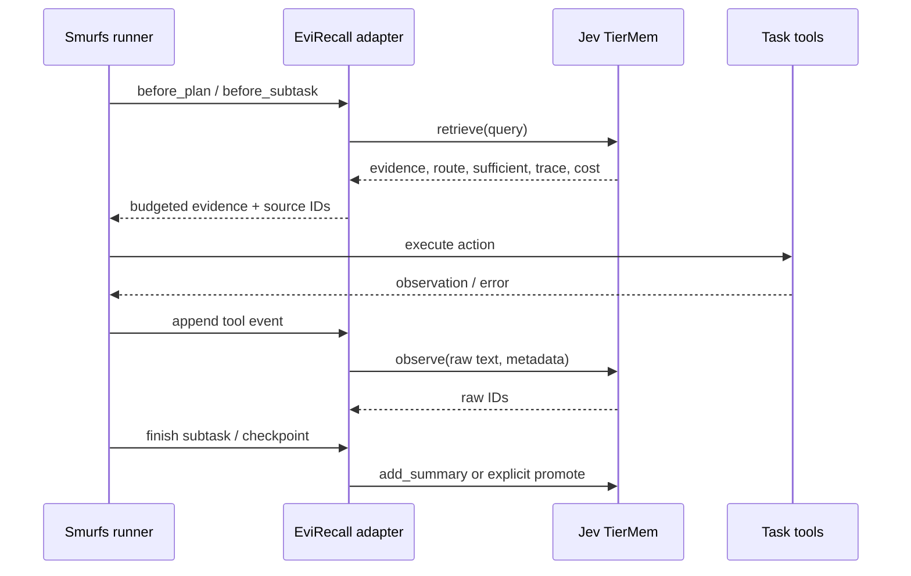

# Smurfs 与 Jev TierMem 接入设计

2026-10-27，设计草案。源码核对版本见 [来源核对](source-audit-2026-10-27.md)。以下标为“拟议”的字段与接口均需要 EviRecall 实现。

## 三个组件各做什么

- **Smurfs**：决定任务如何拆分、调用什么工具、生成什么答案、何时重试或结束。
- **Jev TierMem**：保存摘要和原始历史；由 Jev 判断摘要是否足够，必要时检索原文并补搜；提供有证据约束的写回。
- **EviRecall adapter（拟议）**：决定记录时机和共享范围，封装证据上下文、任务状态、预算、版本关系与实验日志。

Jev 是该轻量实现的判断服务，不等同于整个记忆库，也不是需要与 Smurfs 并行运行的第二套多 Agent 系统。接入方式借鉴通用的“宿主 Agent + 可替换 memory backend”结构；不依赖 Deep Agents / LangGraph，也不声称继承其持久化或恢复能力。

## 首版插入点

核对到的 Smurfs 非流式入口为 `Smurfs/inference/smurfs_worker.py` 中的 `smurfs_worker`。

1. **`decompose_inference()` 规划前。** 根据任务及允许的历史调用记忆检索，给 Planning Agent 注入有长度限制、带来源标识的证据。原始任务和检索上下文分别保存，不修改评测问题文本。
2. **子任务开始前。** 以当前子任务和必要的任务约束检索。避免每一次 token 生成或所有重复角色调用都无条件触发检索。
3. **`Call_function()` 返回后。** 保存工具名、参数、返回状态和原始输出；失败路径也写入事件。不要让 LLM 重写原始工具结果再当作证据。
4. **生成答案和验证前。** Answer Agent 接收证据包；Verifier Agent 如需核验来源，必须显式扩展其参数和 prompt。上游 `verifier_agent.run(question, answer, query_id)` 只有问题与答案，不天然检查 raw IDs。
5. **子任务完成 / 失败后。** 保存角色结论及验证状态。普通阶段摘要用 `add_summary()`；恢复出的新事实可通过 `promote()` 做额外依据判断。

上游 `previous_log` / `history_log` 主要服务当前执行过程，不等同于跨会话持久记忆；核对版本中的 `agents/memory_agent/memory_agent.py` 为零字节，不能当作现成记忆模块。

## 已存在的 Jev 接口

以下方法来自 `jev_tiermem/system.py`，不是 EviRecall 新定义的功能。

- `JevTierMem(directory, session, config, model=None, router=None)`：一个实例定位一个 session，可注入模拟 provider。
- `observe(text, speaker="user", timestamp=None, dia_id=None)`：写入原文，返回分块后的 raw IDs。
- `add_summary(text, raw_ids)`：保存摘要与来源；来源存在性检查不等于摘要内容已获语义验证。
- `compact()`：调用文本模型，处理尚未摘要的原文；产生额外成本。
- `retrieve(query, deepsearch=False)`：返回 `route`、`evidence`、`sufficient`、`summaries`、`trace` 和 `cost`。
- `promote(text, quotes)`：使用 `raw_id` 和逐字引文核对，再交给路由器判断是否写回。
- `answer(query, ...)`：包含该模块自己的回答步骤；首版宿主仍用 Smurfs 作答，避免无意增加第二个回答模型。

特别注意：`retrieve()` 不会自动生成最终答案或完成恢复事实的写回。`deepsearch=False` 仍可能触发多轮 raw 检索；`deepsearch=True` 表示直接从 raw 开始，不能用这个布尔量当作“关闭深搜”的消融。

## 拟议的宿主调用契约

拟议 `MemoryBackend` 提供 `append_event`、`recall`、`checkpoint` 三个宿主操作，分别映射至上述接口；后续增加版本失效操作时应在项目接口中明确，而不是假设上游已有 `invalidate()`。

## 事件与证据包（拟议）

每条宿主事件包含 `run_id`、`condition_id`、`task_group_id`、`session_id`、`event_id`、`agent_role`、`event_kind`、时间、状态及原始内容引用。`event_kind` 区分用户声明、工具观测、Agent 推断和 verifier 意见。

`observe` 可用 `speaker` 记录类型 / 角色，用 `dia_id` 记录稳定事件 ID；不能向上游方法传不存在的 `agent_id` 参数。额外依赖和版本元数据先放在 adapter 管理的独立索引，保存其与 raw IDs 的映射。

返回的 `EvidenceBundle`（项目类型，待实现）包含证据文本、raw/summary IDs、路由结果、充分性与异常状态、预算消耗。需要在检索前限制预算，并在裁剪后重新处理充分性：**Jev 对裁剪前证据的判断不自动适用于裁剪后的内容。**

## 知识更新与失效的最小实现候选

先选择有显式实体、属性、版本或事件顺序的更新案例。例如 `trip_budget` 从旧值变为新值，避免首版同时解决任意自然语言矛盾识别。

保留旧原文，用新增事件表达 supersedes 关系；adapter 维护原始事件到摘要、摘要到决策的依赖。在较新且具权威的约束出现时，将依赖旧值的派生项置为待复核或失效。时间更晚不自动意味着更可信；工具观测、用户修改与 Agent 猜测分别处理。

不得仅在 `retrieve()` 已返回后删掉失效摘要，再沿用上游 `sufficient=True`。实现需要在候选选择 / 路由前过滤，或以过滤后的证据重新检索和判断。可通过薄的存储包装或明确的小补丁实现，保留可关闭的开关。

语义冲突检测与复杂依赖图先不作为最低交付。受控更新扩展的标签只供评测器使用；Agent 可见的是允许出现的更新事件，不可看到标准答案或预先标好的“哪项决策应失败”。

## 状态、隔离和并发

首版建议使用 `condition/run/task_group` 组合形成记忆命名空间。同一连续任务组共享，其他任务组隔离；随机种子和方法条件分别初始化。不要为每个角色建完全隔离的库后又宣称已经测试共享记忆，也不要让所有 benchmark 样本读写一个全局库。

Jev 有实例级锁、SQLite 写锁和 Markdown 原子替换，但这不构成完整的 Smurfs 任务检查点或跨文件事务保证。MVP 采用单协调者串行写入，后续自行验证多进程读写与崩溃窗口。重启恢复需记录任务状态、工具副作用和最后已提交事件；单纯重开同一 session 只证明记忆可再次读取。

## 两种预算

- **运行预算**：任务工具步数、全部模型调用和 token、wall-clock deadline、重试次数。
- **记忆预算**：摘要容量、原文页数、查询改写轮数、提供给角色的证据长度。

上游 `evidence_max_chars` 是字符上限，不是 token 上限；默认 `max_search_rounds=3` 包含首次 raw 检索。摘要达到容量时有明确停止状态，应记录并评估，不能静默丢掉写入。第一版不默认把每个角色的模型输出都摘要一遍。

## Jev 服务与替代实验

轻量版仍需普通文本模型服务，以及独立 Jev 判断服务；接口地址、版本与用量记录在配置中。无需训练不等于无需额外调用。

Jev 判断失败与“证据不足”分别统计。原文回退可以是保守行为，但不得算作 Jev 判断成功。若服务不可用，模拟 router 只用于工程检查；规则或普通 LLM router 的真实实验应使用不同方法名，不冒称 Jev。

## 模型和环境适配的必要检查

Smurfs 上游模型适配与部分角色输出解析较旧，存在未设请求超时、字符串解析等需要评估的实现点。统一客户端、有限重试和结构化解析应作为所有实验组共用的基础修复，并在复现说明中列出，不能只增强实验组。

MemoryArena 桥接需要适配动作到环境的 `step` / 工具接口、最终计划格式、终止信号和观察过滤。可用本地工具包装接到 `tool_env`，但原生 worker 并不是现成的 MemoryArena policy。金标准和评测器内部状态不能作为完整环境对象直接传给 Agent。

## 验收顺序

1. 离线契约：原文写入、重复事件、关闭重开、来源映射、未知字段、错误与预算状态。
2. 单任务集成：Smurfs 产生真实工具输出，存储后另一阶段可回查相应 raw IDs。
3. 真实 provider：验证 Jev 路由、失败路径及全调用成本，不只看最终答案。
4. 小规模 benchmark：固定开发样本，检查金标准隔离、任务组隔离、评测器和时延分段。
5. 冻结协议后再运行测试集。详细状态记录于来源核对与后续实验日志。
